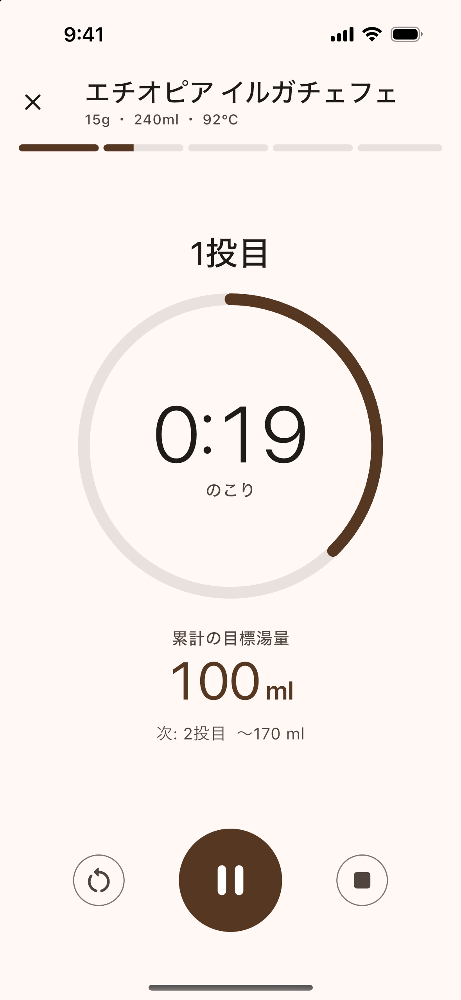
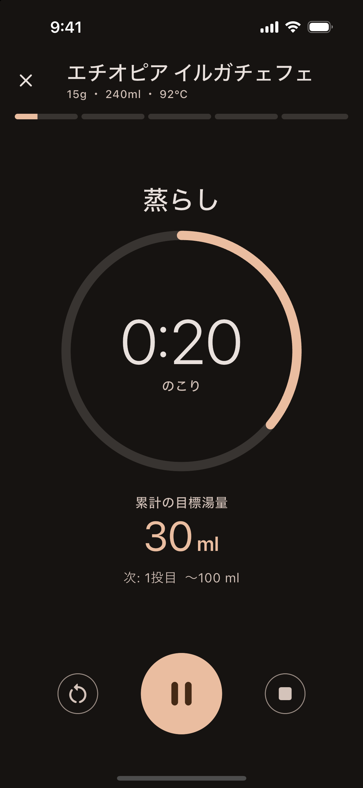
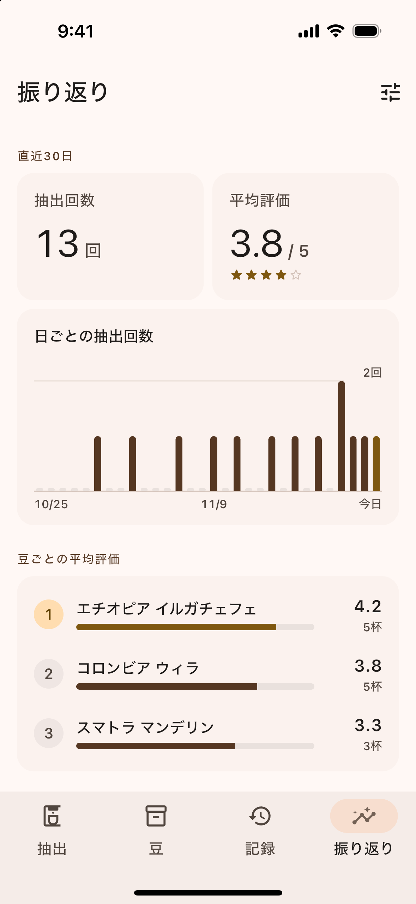
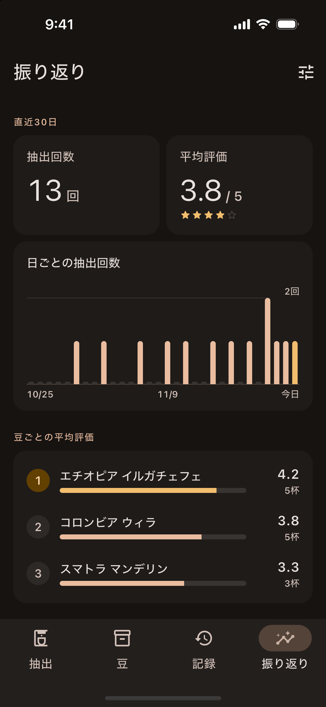

# Brew Log

ハンドドリップ珈琲の抽出タイマー＆記録アプリです。豆を登録し、レシピに沿ってタイマーで淹れ、味を記録して振り返ります。

- 通信は一切行いません。データはすべて端末内（shared_preferences）に保存します。
- UI の言語は日本語です。

| ライト | ダーク |
|---|---|
|  |  |
|  |  |

スクリーンショットはすべて `screenshots/` にあります（各画面のライト・ダーク、計10枚）。

---

## 動作環境

このプロジェクトは **fvm で Flutter のバージョンを固定**しています（`.fvmrc`）。

```
$ fvm flutter --version
Flutter 3.50.1 • channel stable • https://github.com/flutter/flutter.git
Framework • revision ae9b586f34 (5 days ago) • 2026-11-18 17:01:07 -0800
Engine • hash 51379e6df48ea8ee7205623b90fe66491cad8df3 (revision 4d35714800) (5 days ago) • 2026-11-18 01:50:07.000Z
Tools • Dart 3.14.0 • DevTools 2.61.0
```

作業開始時（2026-11-23）に `fvm releases` で確認した stable の最新版が 3.50.1（2026-11-20 リリース）でした。
マシンに直接入っている `flutter` は 3.35.3 と古かったため、使っていません。

> Flutter 3.50 では Material が `package:material_ui` に分離されています。
> そのため、このアプリは `package:flutter/material.dart` ではなく `package:material_ui/material_ui.dart` を import しています。

## 起動方法

```sh
cd brew_log
fvm install            # .fvmrc の 3.50.1 を取得（初回のみ）
fvm flutter pub get
fvm flutter run        # 起動中のシミュレータ／エミュレータで起動
```

その他のコマンド:

```sh
fvm flutter analyze    # 静的解析
fvm flutter test       # unit test + widget test
```

### デモデータで起動する（スクリーンショット撮影用）

`--dart-define` を付けたときだけ、**既存データを上書きして**デモ用の豆3件・記録13件を書き込みます。通常の起動には影響しません。

```sh
fvm flutter run --dart-define=DEMO_DATA=true \
  --dart-define=DEMO_TAB=insights \   # brew / beans / history / insights
  --dart-define=DEMO_THEME=dark \     # light / dark
  --dart-define=DEMO_SCREEN=timer     # 指定するとタイマー画面を開いて自動スタート
```

---

## 画面一覧と画面遷移

| 画面 | 内容 |
|---|---|
| ホーム（下部ナビゲーション） | 「抽出」「豆」「記録」「振り返り」の4タブ。各タブの右上に設定ボタンを置く |
| 抽出（レシピ設定） | 豆の選択（任意）、豆の量・湯量・湯温・蒸らし・注湯回数・投の間隔をステッパーで設定。比率（1:16 など）とステップの流れを確認できる |
| タイマー | 現在のステップ、ステップ内の残り時間（リング）、目標の累計湯量、次のステップを表示。スタート・一時停止・再開・リセット、途中で終えて記録 |
| 味の記録 | ★1〜5、酸味・苦味・甘み（1〜5 のスライダー）、自由記述 |
| 豆一覧 | 焙煎度と、焙煎からの経過日数を表示。スワイプで削除（元に戻せる） |
| 豆の登録・編集 | 名前（必須）、産地、焙煎度（浅・中・深）、焙煎日、メモ。編集時は削除も可能 |
| 記録一覧 | 新しい順。豆のチップで絞り込める |
| 記録の詳細 | 評価・味・メモ・レシピ・実際の抽出時間。削除（元に戻せる） |
| 振り返り | 直近30日の抽出回数と平均評価、日ごとの回数の棒グラフ、豆ごとの平均評価ランキング |
| 設定 | テーマ（ライト／ダーク／システム）、全データの削除（確認ダイアログ付き） |

```
ホーム ─┬─ [抽出] ──▶ タイマー（全画面） ──▶ 味の記録 ──保存──▶ [記録] タブへ
        │                  └─ 中断時は確認ダイアログ
        ├─ [豆]   ──▶ 豆の登録（全画面ダイアログ）／豆の編集
        ├─ [記録] ──▶ 記録の詳細
        ├─ [振り返り]
        └─ 右上の設定ボタン ──▶ 設定
```

データが0件の画面（豆・記録・振り返り）には、線画イラスト・説明文・次にやることのボタン（「最初の豆を登録」「抽出をはじめる」）を出します。
抽出タブで豆が未登録のときは、豆タブへ移動する案内カードを出します（豆を選ばずに淹れることもできます）。

---

## デザイン上の判断

### カラー

| 役割 | 色 | 理由 |
|---|---|---|
| シード | **Coffee #6F4E37** | 中深煎りの豆の色。「珈琲」と聞いて誰もが思い浮かべる茶色で、彩度が低く落ち着いている |
| 展開方法 | `DynamicSchemeVariant.content` | 既定の tonalSpot ではオレンジ〜ピーチ寄りになり甘い印象だった。content ではシード色そのものが primaryContainer に入り、primary はライトで**エスプレッソ色 #553722**、ダークで**ラテ色 #EABDA0** になる |
| アクセント（tertiary） | **Crema #C9A063** から生成 | 自動生成の tertiary はオリーブ色で珈琲らしくなかった。エスプレッソのクレマの金色に差し替え、評価の星・ランキング1位・グラフの「今日」にだけ使う |

- ダークテーマは純黒ではなく、焦げ茶寄りのサーフェス（#161311）です。
- 面の区別には影を使わず、`surface` → `surfaceContainerLow`（カード）→ `surfaceContainerHigh`（ダイアログ）のトーン差を使います。
- **コントラストはテストで確認しています**（`test/unit/theme_contrast_test.dart`）。ライト・ダークそれぞれで、本文・補足文・ボタン・バッジ・エラーバナーなどの文字が WCAG AA（4.5:1）以上、星やグラフの棒などテキスト以外の要素が 3:1 以上であることを確かめています。
- 焙煎度は色だけに頼らず、「●○○ 浅煎り」のように点の数とラベルで示します。

### タイポグラフィ

フォントは**システムフォント**です（iOS は SF Pro + ヒラギノ角ゴ、Android は Roboto + Noto Sans CJK）。
`google_fonts` のような実行時のダウンロードはしていません。

サイズは M3 の既定値に任せています（日本語ロケールでは自動で tall ジオメトリになります）。
`ThemeData.textTheme` では**太さ・字間・行間・等幅数字だけ**を上書きし、役割ごとに次のように使い分けています。

| スタイル | 用途 | 調整 |
|---|---|---|
| displayLarge | タイマーの残り時間 | w300・**等幅数字（tabularFigures）**・字間を詰める。リングの大きさに合わせて拡大 |
| displayMedium | タイマーの目標湯量 | 等幅数字 |
| displaySmall | 振り返りの回数・平均評価 | 等幅数字 |
| headlineMedium | タイマーのステップ名（蒸らし／1投目…） | w500 |
| headlineSmall | 記録の詳細の豆名、ダイアログのタイトル、焙煎日数 | w500 |
| titleLarge | AppBar のタイトル、ステッパーの値 | w600 |
| titleMedium / titleSmall | カード・リストの見出し | w600 |
| bodyLarge / bodyMedium / bodySmall | 本文・説明・メモ | 日本語向けに行間を 1.5〜1.6 に広げる |
| labelLarge | ボタン、数値ラベル | w600・等幅数字 |
| labelMedium | メタ情報（産地、焙煎度、単位） | w500 |
| labelSmall | セクション見出し（オーバーライン） | w600・字間 1.2・primary 色 |

### 余白・角丸・elevation のルール

すべて `lib/app/theme/tokens.dart` の定数と `ThemeData`（`lib/app/theme/app_theme.dart`）に集約しています。画面側でこれ以外の数値はほぼ書いていません（例外は、アイコンの大きさや部品ごとの固定幅など、その部品に固有の寸法だけです）。

- **余白 `AppSpace`**: 4dp グリッドの 4 / 8 / 12 / 16 / 24 / 32 / 48。画面の左右は 16（360dp 幅でも本文幅 328dp を確保）、セクション間は 24、カード内は 16。
- **角丸 `AppRadius`**: 小さい部品ほど小さく、面が大きいほど丸くする
  - 8: 入力欄・チップ・バッジ・SnackBar
  - 16: カード・リスト・ボタン・FAB
  - 28: ダイアログ・ボトムシート
  - pill: 進捗バー
- **elevation `AppElevation`**: 0（通常の面）／2（スクロール時の AppBar・FAB）／3（ダイアログ）。影ではなくトーンで面を分けます。
- **モーション `AppMotion`**: 150 / 250 / 400ms。カーブは easeOutCubic を基本にし、「控えめ」を保つため 400ms を超えないようにしています。

### こだわった点

- **タイマー画面**: 一番大事な「あと何秒」と「何 ml まで注ぐか」を最大の文字で中央に置き、操作は親指が届く下部に集めました。上部のステップバーは、各セグメントの幅がステップの長さに比例します。ステップが切り替わるとステップ名が下からスライドインし、ハプティクスが鳴ります。
- **タイマーの正確さ**: 経過時間は周期タイマーで足し算せず、「一時停止までの累計 + 再開時からの時計の差分」で求めます。アプリがバックグラウンドに回って周期タイマーが止まっても、戻ったときに正しい位置へ追いつきます。
- **湯量の配分**: 蒸らしは豆の量の2倍、残りを注湯回数で等分します。端数は最後の投で吸収するため、累計は必ず総湯量ぴったりで終わります。
- **アニメーション**: タブ切替はフェード＋わずかな拡大、Android の画面遷移は FadeForwards、iOS はスワイプで戻れる標準の遷移です。リスト項目は少しずつ遅らせてフェードインし、削除はスワイプで消えたあと「元に戻す」を出します。OS の「視差効果を減らす」設定が有効なときは、入場アニメーションを止めます。
- **開始ボタンの固定**: 抽出タブの「抽出をはじめる」は画面下に固定し、レシピの要約（15g・240ml・2:30）も載せています。
- **空状態のイラスト**: 画像アセットは使わず、CustomPaint の線画（カップ・豆・グラフ）をテーマ色で描いています。そのためダークでも浮きません。
- **小さい画面**: 360×640dp と、文字サイズ 1.3 倍のときにはみ出さないことを widget test で確認しています。タイマーのリングは画面の幅と高さの両方から大きさを決めます。

---

## 使用パッケージと選定理由

| パッケージ | 用途 | 選定理由 |
|---|---|---|
| `material_ui` | Material 3 ウィジェット | Flutter 3.50 で Material がフレームワークから分離されたため必須（テンプレートが標準で追加する） |
| `flutter_riverpod` | 状態管理 | 画面から状態とデータ層を切り離せ、テストでは `overrides` で保存先や端末機能を差し替えられる。コード生成（riverpod_generator / build_runner）は使わず、`Notifier` を手書きして依存を最小限にした |
| `shared_preferences` | 永続化 | データは豆が数十件・記録が数百件程度の想定で、JSON 文字列で十分に扱える。SQLite 系（drift / sqflite）はスキーマ管理やコード生成のコストに見合わない。同期的に読める `SharedPreferencesWithCache` を使っている |
| `wakelock_plus` | タイマー実行中のスリープ防止 | Flutter 標準にはスリープ抑止の API がないため。実行中だけ有効にし、一時停止・完了・画面を閉じたときに解除する |

- ハプティクスは標準の `HapticFeedback`、グラフは `CustomPaint`、日付の書式は自作の小さな関数で、追加パッケージは使っていません（`intl`・グラフ系・`uuid` などは不要と判断）。
- テンプレートが追加する `cupertino_icons` は使っていないため削除しました。

---

## フォルダ構成

```
lib/
├── main.dart                  起動処理（保存領域を開いて読み込み → ProviderScope）
├── app/
│   ├── app.dart               MaterialApp（テーマ・ロケール）
│   └── theme/
│       ├── app_theme.dart     ColorScheme / TextTheme / 各コンポーネントのテーマ
│       └── tokens.dart        余白・角丸・elevation・モーションの定数
├── data/                      ── データ層
│   ├── models/                Bean / BrewRecord / Recipe / AppSettings（JSON 変換と検証）
│   ├── storage/               KeyValueStore（shared_preferences 実装とメモリ実装）
│   └── repositories/          BrewLogRepository（読み込み失敗の扱いはここに集約）
├── domain/                    ── 純粋なロジック（Flutter の UI に依存しない）
│   ├── brew_schedule.dart     レシピ → ステップ、経過時間 → 現在位置
│   └── brew_stats.dart        直近30日の集計、豆ごとのランキング
├── state/                     ── 状態層
│   ├── app_providers.dart     Riverpod の Provider / Notifier
│   ├── brew_timer_controller.dart  タイマーの状態機械（ready / running / paused / finished）
│   └── device_services.dart   ハプティクス・スリープ抑止・時計の抽象
├── features/                  ── 画面（機能ごと）
│   ├── home/  brew/  beans/  history/  insights/  settings/
├── ui/                        ── 画面をまたいで使う部品
│   ├── widgets/               空状態・評価の星・味のバー・共通部品
│   └── format.dart, id.dart
└── dev/demo_data.dart         スクリーンショット用デモデータ（dart-define 指定時のみ）
```

## データの保存と、壊れていたときの扱い

- 豆・記録・設定を、それぞれ別のキーに JSON で保存します。
- 読み込みは `BrewLogRepository` に集約しており、**例外を外に出しません**。
  - JSON として読めない場合 → 元の文字列を `*.corrupt` キーに退避し、空の状態で起動します。
  - 一部の項目だけ壊れている場合 → その項目だけ読み飛ばし、元データを退避します。
  - 保存領域そのものを開けない場合 → メモリ上で動かし、「閉じると内容が失われる」ことを知らせます。
  - 保存に失敗した場合 → 操作はそのまま続けられるようにし、空き容量の確認を促します。
- 見つかった問題は、ホーム上部のエラー色のバナーで日本語で知らせます（「閉じる」で消せます）。

---

## テスト

```
$ fvm flutter test
00:04 +63: All tests passed!
```

| ファイル | 種類 | 内容 |
|---|---|---|
| `test/unit/brew_schedule_test.dart` | unit | ステップの組み立て、湯量の配分（端数、単調増加、総量一致）、蒸らし0秒、境界の時刻、完了判定 |
| `test/unit/brew_timer_controller_test.dart` | unit | 開始・一時停止・再開・リセット、ステップ切替の通知回数、完了通知が1回だけであること、tick が遅れても追いつくこと |
| `test/unit/brew_stats_test.dart` | unit | 直近30日の範囲の境界（29日前／30日前／未来）、月またぎ、平均、ランキングの並び順、削除済みの豆・名前変更 |
| `test/unit/repository_test.dart` | unit | 保存と読み戻し、壊れた JSON、一部だけ壊れた項目、壊れた設定、全削除、焙煎からの経過日数 |
| `test/unit/theme_contrast_test.dart` | unit | ライト・ダークの主要な配色の組み合わせのコントラスト比 |
| `test/widget/app_flow_test.dart` | widget | 各タブの空状態、豆の登録（入力チェック付き）、タイマー → 記録の一連の流れ（ハプティクスとスリープ抑止の呼び出しも確認）、履歴の絞り込みと詳細、振り返りの数値、全データ削除、テーマ切替、壊れたデータでのバナー表示 |
| `test/widget/small_screen_test.dart` | widget | 360×640dp で全タブ・タイマー・記録入力がはみ出さないこと、文字サイズ 1.3 倍でもタイマーが崩れないこと |

---

## 検証したこと／未検証・既知の問題

### 実際に検証したこと

| 項目 | 結果 |
|---|---|
| `fvm flutter analyze` | **No issues found!**（警告・info とも 0） |
| `fvm flutter test` | **63 件すべて成功**（unit 52 件・widget 11 件） |
| iOS シミュレータ（iPhone 15 Pro / iOS シミュレータ、`fvm flutter run`） | デモデータなしで起動し、空状態の抽出タブが表示されること、起動ログに例外やオーバーフローが出ないことを確認 |
| iOS シミュレータ（デモデータあり） | 抽出・タイマー（自動スタートで実際に時間が進み、蒸らし → 1投目へ切り替わる）・豆・記録・振り返りの各画面を、ライト・ダークで表示して目視で確認し、`screenshots/` に保存 |
| Android | `fvm flutter build apk --debug` が成功すること（ビルドのみ） |
| 360dp 幅・文字サイズ 1.3 倍 | widget test で、はみ出しの例外が出ないことを確認 |
| 壊れた保存データ | unit test と widget test で、クラッシュせずに空で起動し、バナーで知らせることを確認 |
| ハプティクス・スリープ抑止 | widget test で、ステップ切替時・完了時・開始／一時停止時に呼び出されることを確認（偽物の実装に差し替えて検証） |

スクリーンショット（`screenshots/`）:

| ファイル | 画面 |
|---|---|
| `01_recipe_light.png` / `06_recipe_dark.png` | 抽出（レシピ設定） |
| `02_timer_light.png` / `07_timer_dark.png` | タイマー（実行中） |
| `03_beans_light.png` / `08_beans_dark.png` | 豆一覧 |
| `04_history_light.png` / `09_history_dark.png` | 記録一覧 |
| `05_insights_light.png` / `10_insights_dark.png` | 振り返り |

### 未検証のこと・既知の問題

- **Android エミュレータでは起動していません**（APK のビルドまで）。画面遷移（FadeForwards）の見た目も Android 実機・エミュレータでは未確認です。
- **ハプティクスとスリープ抑止の実機での効き目は未確認**です。シミュレータは振動せず、スリープもしないためです。呼び出していること自体はテストで確認しています。
- シミュレータで表示を確認したのは iPhone 15 Pro（幅 393pt）だけです。360dp 幅はテスト上の確認のみで、実機・エミュレータでは見ていません。
- 次の画面はシミュレータでは目視していません（widget test でのみ確認）: 豆の登録・編集、味の記録、記録の詳細、設定、各タブの空状態（抽出タブの空状態はシミュレータでも確認済み）、データ破損時のバナー。
- VoiceOver / TalkBack での読み上げは未確認です（主要な数値やグラフには Semantics のラベルを付けています）。「視差効果を減らす」設定で入場アニメーションが止まることも、実機では未確認です。
- **バックグラウンドでの通知はしません**。アプリを離れている間にステップが切り替わっても、知らせる手段はありません（戻れば正しい経過時間に追いつきます）。
- 保存は shared_preferences 上の JSON です。記録が数千件規模になると、保存のたびに全件を書き直すため遅くなる可能性があります（想定している使い方では問題ない規模です）。
- 豆を削除しても記録は残ります（記録時の豆名で表示）。記録の履歴をスワイプで削除する機能はなく、詳細画面から削除します。
- 日付と時刻は端末のローカル時刻で記録します。タイムゾーンをまたいで移動した場合、「直近30日」の日付の区切りがずれることがあります。
- 当初は、スクリーンショット撮影用のデモ設定を `xcrun simctl launch` の環境変数（`SIMCTL_CHILD_*`）でも渡せるようにしようとしましたが、アプリに届かなかったため、`--dart-define` 方式だけにしました。
